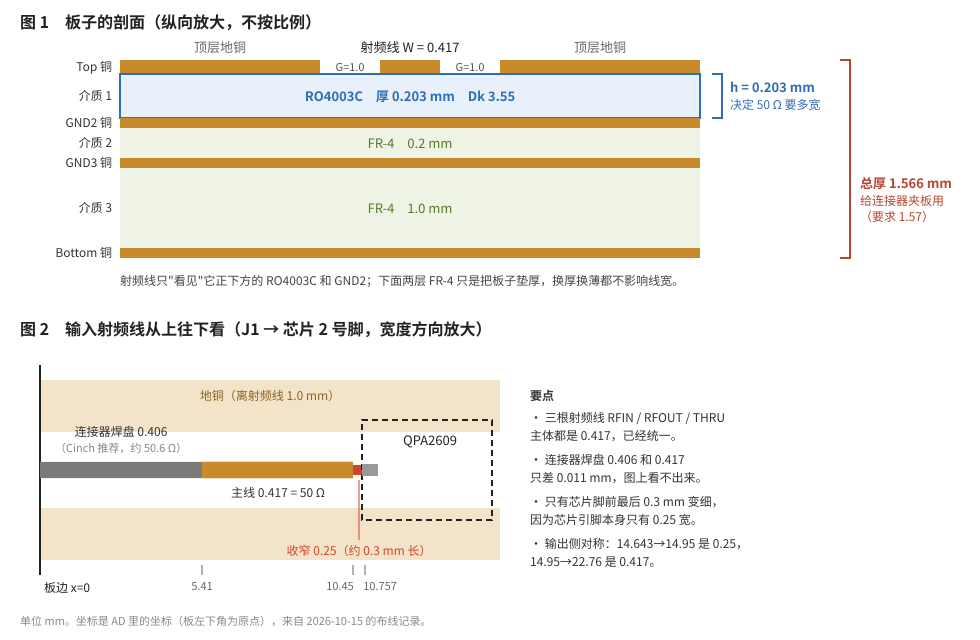

# 厚度、阻抗、线宽三个"统一"：对照 QPA2609 测试板

2026-10-18 写。老师要求"厚度统一、阻抗匹配统一、微带线宽度统一"。这份说明对照我们已经画好的 QPA2609 测试板，讲这三件事是什么、我们这块板做到了哪一步、还差什么。数字都来自之前的画板记录（`3_AD23操作手册\操作记录\叠层与线宽记录_20261014.html` 和 10/15～10/17 的对话）。

> 全组要照着做的正式标准（含拼成整板用的模块接口）见 [射频测试板统一设计标准_草案.md](射频测试板统一设计标准_草案.md)。本文是讲道理的说明。

## 先说结论

1. **这三件事其实是一件事。** 板材和厚度定了，要做到 50 Ω，线宽就只剩一个答案。所以"统一"的核心是**统一叠层**：叠层一样，阻抗和线宽自然一样。
2. **我们这块板自己内部已经统一了。** 只用了一套叠层，三根射频线 RFIN、RFOUT、THRU 都是 50 Ω、都是 0.417 mm 宽。
3. **和之前 v7.1 那套 HMC1082 测试板的方案不统一。** 那套用的是另一种板材、另一个厚度、另一种走线方式（见第 4 节）。老师要的统一，应该就是让各块测试板都用同一套参数。
4. **建议以这块板的参数作为全组的标准**（第 5 节有一张表），但要先让板厂确认能做。板厂要是改了，全组一起改。

---

## 1　三件事各是什么

可以把射频信号想成水在水管里流。

| 老师说的 | 是什么 | 打个比方 |
|---|---|---|
| **阻抗匹配统一** | 信号走过的每一段（仪器、电缆、连接器、板上的线、芯片引脚）都是 50 Ω | 整条水管一样粗。哪里突然变粗变细，水就会在那儿"撞回来"。信号撞回来就叫反射，测出来的数就不准 |
| **厚度统一** | 板子用同一种板材、同样厚 | 管壁的材料和厚度一样 |
| **微带线宽度统一** | 板上 50 Ω 的射频线都画成同一个宽度 | 管子的粗细一样 |

**为什么说是一件事：** 一根线是不是 50 Ω，取决于三样东西：线有多宽、线下面那层板材有多厚、这层板材的 Dk（介电常数，可以理解成"板材对信号的拖慢程度"）。板材和厚度一旦定了，50 Ω 对应的线宽就是确定的一个数。AD 层叠管理器里的阻抗计算做的就是这件事：给它叠层，它算出多宽是 50 Ω。

所以只要大家叠层一样，算出来的线宽一定一样；叠层不一样，硬把线宽画成一样，阻抗反而不对了（第 4 节有例子）。

## 2　"厚度"其实有两个，别弄混

| | 我们的数 | 管什么 |
|---|---|---|
| **射频介质厚度 h**（顶层和第 2 层之间那一层） | RO4003C，**0.203 mm**，Dk 3.55 | **决定线宽。** 射频线只"看见"它正下方这一层和下面的地（GND2） |
| **成品总厚** | **1.566 mm**（AD 显示 61.636 mil，含两面阻焊） | **决定能不能装连接器。** 我们用的 Cinch 142-0761-851 是板边夹着焊的，要求板厚 0.062 in = 1.57 mm |

下面两层 FR-4（0.2 mm 和 1.0 mm）只是为了把板子垫到 1.57 mm 厚，它们换厚换薄都不影响射频线宽。

所以老师说"厚度统一"，两个厚度都要统一：

- h 统一，线宽才能统一；
- 总厚统一，所有测试板才能用同一种连接器。

每一层多厚、为什么不照官方评估板做 0.33 mm 薄板，见 [板子厚度说明.md](板子厚度说明.md)。供电见 [../5_供电/QPA2609供电说明.md](../5_供电/QPA2609供电说明.md)。

## 3　我们这块板现在的状态

### 3.1　已经统一的

| 项目 | 数值 | 出处 |
|---|---|---|
| 叠层 | 4 层：Top 铜 / RO4003C 0.203 / GND2 / FR-4 0.2 / GND3 / FR-4 1.0 / Bottom，铜都是 1 oz | AD 层叠管理器（10/14 截图 05） |
| 阻抗目标 | 单端 50 Ω，参考 GND2 | AD 阻抗配置 S50 |
| 射频线宽 W | **0.417 mm**（AD 显示 16.422 mil，算出 50.01 Ω） | AD 阻抗计算（10/14 截图 06） |
| 线边到两侧地铜的距离 G | 1.0 mm | 自己定的，官方评估板约 1.6 mm |
| 三根射频线 | RFIN、RFOUT、THRU 主体都是 0.417 | 线宽规则 RF_Width：0.2 / 0.417 / 0.417 |
| 连接器 | 4 个都是 Cinch 142-0761-851 | 元件与库来源 |

### 3.2　板上故意"不一样宽"的三处，都不算违反统一

**① 芯片引脚前最后约 0.3 mm 收窄到 0.25 mm。** QPA2609 的引脚焊盘本身只有 0.25 宽，0.417 的线接不上去，只能在最后变细。0.25 宽的线大约 67 Ω，所以细的这段越短越好。我们照 Qorvo 官方评估板，把宽线一直拉到 x = 10.45 才收窄，细段几乎全压在引脚焊盘上（输出侧对称，在 14.95）。

> 这里有过一次改动：最早让你在 x ≈ 9.4 收窄（照手册"离芯片约 1 mm 收窄"的说法写的，没实测），10/15 对照官方板 Gerber 后改成 10.45。粗算 14 GHz 时，细段 1.3 mm 长回损约 15 dB，缩到 0.3 mm 约 29 dB。

**② 连接器焊盘 0.406 mm。** 这是 Cinch 手册推荐的尺寸，按我们的叠层算约 50.6 Ω，和 0.417 只差 0.011 mm，等于是同一个宽度，不用改封装。

**③ 射频线上开了阻焊窗。** AD 算 0.417 时假设线上盖着一层绿油；后来照 Cinch 的要求和官方板，射频线和两侧的缝都不盖绿油了。去掉绿油后我用公式重算，0.417 是 50.4 Ω，差不到 1 Ω，不用改线宽。

> 统一的是"50 Ω 主线"这一个宽度。芯片引脚、连接器焊盘那一小段跟着器件走，每颗芯片引脚不一样宽，这是允许的。

### 3.3　还没确定的

**叠层还没拿给板厂确认。** 这是最大的风险：板厂要是没有 0.203 mm 的 RO4003C，或者 Dk 取值不同，W 就要重算。比如板厂按 Dk 3.38 做，0.417 是 51.5 Ω，影响不大；要是换成别的板材或别的厚度，影响就大了（见下一节）。

## 4　和 v7.1 的 HMC1082 测试板方案对比：这就是"不统一"

v7.1 那套 HMC1082LP4E 测试板文档是照 ADI 官方评估板写的，和我们这块对比如下：

| | QPA2609 测试板（v8，已画） | HMC1082 测试板方案（v7.1，文档） |
|---|---|---|
| 射频介质 | RO4003C，**0.203 mm**，Dk 3.55 | RO4350B，**0.254 mm**（10 mil），Dk 3.66 |
| 总厚 | 1.566 mm | 约 1.6 mm |
| 走线方式 | 地铜离线 1.0 mm，基本就是普通微带线 | 地铜紧贴在线两侧（间距按公式估算约 0.13～0.15 mm，没从官方文件量到），叫"接地共面波导" |
| 50 Ω 线宽 | **0.417 mm** | **0.406 mm**（16 mil） |
| 靠近芯片收窄到 | 0.25 mm | 0.25 mm（10 mil） |

**两个线宽数字差不多，但这不叫统一。** HMC1082 那块能用 0.406 做到 50 Ω，是因为地铜紧贴在线两边，把阻抗拉低了；我们这块地铜离得远，靠的是更薄的板材。原理不同，各自只在自己的叠层上是 50 Ω。

举个例子，把我们的 0.417 线原样画到 HMC1082 那种 0.254 mm 的 RO4350B 上（地铜离远一些），公式估算约 **56 Ω**；同样的叠层要做到 50 Ω，线要约 0.52 mm 宽。两块板串起来测，接口那里就是一个阻抗台阶。

v8 已经把 PA 换成了 QPA2609，HMC1082 那块板不一定还要做；但它说明了一个问题：**每块板各自照自己芯片的官方评估板抄，叠层就会五花八门。** 老师要求统一，就是要避免这个。

## 5　建议的统一标准

后面滤波器（MFBP-00144CSP3）、移相器（MAPS-010166）、隔离器等测试板，以及以后的整条链路板，都按这张表画：

| 项目 | 统一取值 | 说明 |
|---|---|---|
| 层数 | 4 层 | Top 走线和器件；GND2 完整地；GND3 地；Bottom 地 |
| 射频介质 | RO4003C，0.203 mm，Dk 3.55，Df 0.0027 | 等板厂确认 |
| 下面两层 | FR-4 0.2 mm + FR-4 1.0 mm | 只用来凑厚度 |
| 铜厚 | 1 oz | 等板厂确认成品铜厚 |
| 成品总厚 | 1.57 mm（0.062 in） | 配 Cinch 142-0761-851 |
| 射频连接器 | Cinch 142-0761-851 | 全组同一型号，焊盘照 Cinch 推荐 |
| 阻抗 | 单端 50 Ω，参考 GND2 | |
| 射频主线宽 W | 0.417 mm | 板厂复核后以板厂数为准 |
| 线到地铜 G | 1.0 mm | 不能比 1.0 小太多，否则阻抗会变 |
| 射频线阻焊 | 开窗，不盖绿油 | Cinch 要求 |
| 靠近芯片 | 宽线拉到引脚焊盘跟前再收窄，收窄宽度等于该芯片引脚焊盘宽 | 细段尽量短 |

**画新板最稳的做法：** 把 QPA2609 测试板的 PcbDoc 另存一份当模板，叠层、阻抗配置、线宽规则就都带过去了，不用重新填。

## 6　要去问的

**问老师：**

- "统一"是指组里所有单器件测试板，还是也包括以后的整条链路板？（建议两者都按第 5 节的表。）
- 组里别的同学的测试板如果已经用了别的叠层，以谁为准？

**问板厂**（`操作记录\叠层与线宽记录_20261014.html` 里有一段可以直接复制的问话）：

- 有没有 0.203 mm 的 RO4003C 芯板，能不能和 FR-4 混压到 1.57 mm；
- 他们算阻抗用的 Dk 是多少，0.417 是不是 50 Ω；
- 成品铜厚。

板厂改了任何一个数，W 就要在 AD 里重算一次，然后**全组同步改**，不能只改自己那块。

## 7　汇报时可以这样说

> 我们这块 QPA2609 测试板用的是 4 层混压：顶层下面是 0.203 mm 的 RO4003C，下面用 FR-4 垫到 1.57 mm，以适配板边 SMA。在这个叠层上，AD 算出 50 Ω 线宽为 0.417 mm，三根射频线都按这个宽度画，只在芯片引脚前约 0.3 mm 收窄到引脚宽度 0.25 mm。建议其他测试板统一采用这套叠层、0.417 mm 线宽和同一型号连接器，待板厂确认叠层后全组同步。
