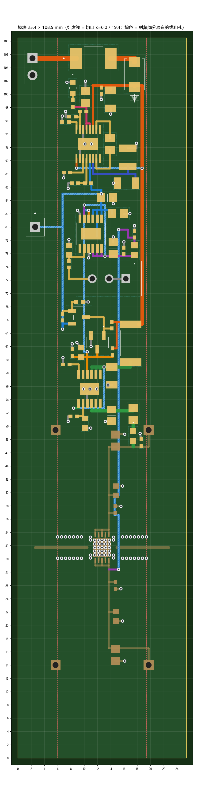

# QPA2609 模块（射频 + 自带供电）：完成步骤总指南

2026-10-20 写（同日第二版，取代"独立供电板"那一版）。打 **【未见过】** 的菜单是我没在你的 AD 截图里见过、照 Altium 官方文档写的，对不上就截图发我。

---

## 0　先看这一页

### 0.1　做成什么样

- **一块板 = 一个模块**：下面是原来的 QPA2609 射频部分（**坐标一点不动**），上面加一条供电区，板子从 51.4 mm 加长到 **108.5 mm**，宽还是 25.4 mm。
- **供电区全在两条切口之间**（图上红虚线 x = 6.0 和 19.4）。拼整条链路时，从切口切下来的这一整条就是"QPA2609 + 它自己的供电"，测试板上测的就是拼上去以后的样子。
- **只给测试用的东西在切口外面**：12 V 插针 P101（左上）、−5 V 测试点 TP103（左边）、原来的 J3～J6 端子，拼整板时和 SMA 一起切掉。整板上每个模块只要接一根 12 V。
- **VG 怎么过射频线**：走第 3 层（GND3），从**芯片右边和 RFOUT 第一个屏蔽孔（x = 15.8）之间的缝**穿过去，**一个屏蔽孔都不拆**；第 2 层地完整，《统一要求》第 5、8 条照常满足。

### 0.2　一共几步

| 部分 | 做什么 | 大约多久 |
|---|---|---|
| **A 准备** | 备份、两条阻焊规则 | 15 分钟 |
| **B 加供电** | 加库 → 新建一页原理图 → 删旧接地孔和铺铜 → 板子加长 → 导入 → 摆元件 → 过孔 → 布线 → 铺铜 → 重打接地孔 | 5～6 小时，分 2～3 次 |
| **C 收尾出图** | 标注、3D、最终 DRC、Gerber | 1 小时 |
| **D 上电** | 先不焊芯片调供电，再焊芯片调到 120 mA | 板子回来后 |
| **E 下单前** | 问板厂、买料、仿真 | 穿插做 |

### 0.3　和《方案一完善说明》不一样的地方

| # | 原来 | 现在 | 为什么 |
|---|---|---|---|
| 1 | LTC3260 的 EN−（13 脚）接 12 V | **接旁边的 +5 V（12 脚 LDO+）** | 13 脚和 12 V 的 11 脚中间夹着 12 脚，走不过线。接 +5 V 效果一样：+5 V 一出来负压就启动；拔电时 +5 V 要等输入掉到 2 V 多才没，那时负压早停了，上电断电顺序不变。手册写 EN− 可接 36 V 以内的高电平。【手册 + 判断】 |
| 2 | 7 个测试点 TP101～TP107 | **只留 TP103（−5 V）**，放在切口外 | 供电区只有 13 mm 宽。VG 在 J4 量、VD 在 J3 量、电流量 R116 两头、12 V 在 P101 量，够用 |
| 3 | 故障测试"EN− 接地" | **"TP103 用导线接地"** | EN− 现在接在 +5 V 上，接地会短路 +5 V。LTC3260 手册写 LDO− 输出短路可以一直短着 |

其余元件值、上电顺序、负压门卫都没改。

### 0.4　我核查了什么

- **库**：10 个下载的器件库都对照过手册（`5_供电\供电芯片库_AD\来源说明.md`）；AD 自带库的封装名、焊盘是从你这台电脑的库文件读出来的。
- **布局**：坐标是脚本按库里真实焊盘算的，并且把射频部分原有的线、电容、屏蔽孔、芯片过孔都放进去一起查：不同网络最近 **0.20 mm**（规则 0.15）、0 短路、0 漏连、0 元件重叠、阻焊桥都够宽、供电元件全在切口之间。47 个元件、45 个过孔、105 根走线都在下面的表里。
- **没核实的**：打【未见过】的菜单；射频部分原有的线是按你 10/16 的记录建的模型（你后来要是挪过，DRC 会报出来）；LTspice 仿真还没做（E1）。

### 0.5　每一层怎么弄（总表）

| 层 | 射频部分原来有的（**不动**） | 这次要做的 | 注意 |
|---|---|---|---|
| **Top Layer**（顶层铜） | 射频线 RFIN/RFOUT/THRU、芯片和电容焊盘、VD/VG 原有走线、GND 铺铜 | 47 个新元件**全部贴在这层**；98 根走线（0.3 mm 90 根、0.5 mm 6 根、0.8 mm 2 根）；最后重铺 GND，范围 (0,0)～(25.4,108.5) | 射频线两边 1 mm 内不铺铜，靠原有的 RF_to_Pour 规则自动做到；铺铜设置照第 6 章：Solid、Pour Over All Same Net Objects、Remove Dead Copper |
| **GND2**（第 2 层铜，射频线的参考地） | 整层 GND 铺铜 | **不走任何线**，只按新板框重铺整层 GND | 必须完整（《统一要求》第 5 条），所以 VG 不走这层 |
| **GND3**（第 3 层铜） | 整层 GND 铺铜 | **只走 1 根线**：VG（第 104 号，0.3 mm，从 (15.2, 79.6) 到 (15.2, 28.4)）；然后重铺整层 GND | 重铺时地铜会在这根线两边自动让开 0.15 mm；它从芯片右边和 RFOUT 第一个屏蔽孔之间穿过，不拆孔 |
| **Bottom Layer**（底层铜） | GND 铺铜 | 6 根跳线（第 98～103 号，0.3 mm）；重铺 GND | 跳线只是为了躲开顶层的交叉，底层没有元件 |
| **过孔**（穿 4 层） | 手放的 137 个保留（屏蔽孔、连接器、芯片中心、电容旁）；自动打的 333 个删掉 | 新放 45 个（孔 0.25 / 直径 0.5，按表填 Net）；铺铜后重新自动打一遍缝合孔 | 全部由原有的 Via_Tent 规则盖油 |
| **Mechanical 1**（板框） | 25.4 × 51.4 的 4 根线 | 换成 25.4 × 108.5，再定义板形 | 出 Gerber 时要勾这层 |
| **Top Solder**（顶层阻焊） | 3 条射频开窗 Fill | **不加 Fill**；新加规则 IC_Mask：U1、U101、U102、U103 的焊盘阻焊外扩 0.05 mm；Sliver 规则改 0.08 mm | 其他焊盘保持默认外扩 0.1016 mm |
| **Bottom Solder**（底层阻焊） | 4 个连接器下面的开窗 Fill | 不动 | — |
| **Top Overlay**（顶层丝印） | 位号、连接器框 | C1：34 个小元件位号隐藏，13 个关键位号挪到算好的位置，加 9 个功能字（字高 0.8 mm） | 字都不压焊盘和过孔（已算好）；剩下的丝印报警可以不管 |
| **Top Paste**（钢网） | 由焊盘自动生成 | 不用动 | 只有找厂家贴片时才需要处理（比如 U1 中间焊盘分小窗） |
| **叠层、介质** | RO4003C 0.203 / FR-4 0.2 / FR-4 1.0，总厚 61.636 mil | **不改** | — |

### 0.6　要带到 AD 电脑上的东西

1. `QPA2609测试板\5_供电\供电板_AD库_平铺\`：20 个库文件
2. `QPA2609测试板\7_完成指南\`：本指南、网页版（可以勾进度、点走线看位置）、`模块_数据表.xlsx`、图

---

## A　准备

### A0　备份

关掉 AD，把整个射频板工程文件夹复制一份，改名加日期，比如 `QPA2609_test_备份_20261020`。之后都在原文件夹里改。

### A1　Sliver 规则改成 0.08 mm

**设计 → 规则（Design → Rules）**，左边 **Manufacturing → Minimum Solder Mask Sliver**，数值改 `0.08mm`，确定。

### A2　芯片阻焊外扩 0.05 mm（射频芯片和三颗供电芯片一起）

AD 默认焊盘阻焊外扩 0.1016 mm，0.5 mm 间距的引脚之间只剩 0.047 mm 绿油，太窄；官方评估板是 0.05 mm（《官方板对照核查》里从 Gerber 读的）。

1. **设计 → 规则**，左边树找到 **Solder Mask Expansion** 分类（做 Via_Tent 的那个），右键 → **新规则**，单击新出来的那条。
2. 名称 `IC_Mask`；Where The Object Matches 选 **Custom Query**，填：
   `InComponent('U1') Or InComponent('U101') Or InComponent('U102') Or InComponent('U103')`
3. 外扩填 `0.05mm`（顶层底层一样），**不勾**盖油。
4. **优先级**：`IC_Mask` 排在默认 `SolderMaskExpansion` 前面。确定。

（现在还没有 U101～U103，规则先建好，导入后自动生效。）引脚内端到 U1 中间焊盘的绿油只有 0.09 mm，能不能做要问板厂（E2 第 3 条）；做不出来板厂会去掉这一小条，不影响电气。

---

## B　加供电

### B1　把库加进工程

1. 资源管理器：在射频板工程文件夹里建 `Lib_供电` 文件夹，把 `供电板_AD库_平铺` 里 20 个文件拷进去。
2. AD 左边 Projects 面板：右键工程名 → **Add Existing to Project** → 进 `Lib_供电`，**Ctrl + A** 选中 20 个 → 打开。（和《元件与库来源》4.2 一样）

做对了：Libraries 下面多了 10 个 `.SchLib`、10 个 `.PcbLib`。

### B2　原理图：新建一页"供电"

#### B2.1　新建一页、让两页的网络名互通

1. 右键工程名 → **Add New to Project → Schematic**，**File → Save**，存成 `Power.SchDoc`。
2. **Project → Project Options**【未见过】→ **Options** 选项卡 → **Net Identifier Scope** 选 **Global (Netlabels and ports global)** → OK。
   这样新页上的 `VD`、`VG`、`GND` 标号会和射频那一页的同名网络连在一起（Altium 文档：没有端口时默认也是这样，选 Global 是为了保险）。

#### B2.2　放元件、改值和封装

和手册第 3 章一样：**Panels → Components**，切库，双击元件，**按 Tab 先填位号**，单击放下。

- 电阻 `Res2`、电容 `Cap`（Miscellaneous Devices）：Value 填值，Comment 填 `=Value`；**Add → Footprint** 填表里封装名；删掉自带的 `AXIAL-0.4` / `RAD-0.3`。同种的改好一个再复制。
- 10 个下载的器件：封装已经关联好，不用改。
- P101 用 `Header 2`，TP103 用 `Socket`（Miscellaneous Connectors），默认封装就对。
- 封装名照抄：`1608[0603]` 带方括号，0805 是 `6-0805_N`，1206 是 `C1206`，1210 是 `C1210`，2512 是 `RESC6332`。

#### B2.3　连线：每个脚拉一小段线、放网络标号

和手册 3.3 画 U1 一样：每个脚引一小段线（Ctrl + W），线上放网络标号（**Place → Net Label**，Tab 填名字），接 `GND` 的放地符号（**Place → Power Port**，Name `GND`，Style `Power Ground`）。写"空着"的脚不接。

两脚元件**分 1 脚、2 脚**（布局按这个算）：`Res2`、`Cap` 不转时 **1 脚在左、2 脚在右**；`Header` 从上往下 1、2 脚。**`VD`、`VG` 两个标号的名字必须和射频页一模一样**（大写，没有空格）。

| 位号 | 库 / 元件名 | 值（Value）/ 备注 | 封装（Footprint） | 引脚 → 网络名 |
|---|---|---|---|---|
| C101 | Miscellaneous Devices `Cap` | 10uF 25V | `C1206` | 1→**V12_IN**；2→**GND** |
| C102 | Miscellaneous Devices `Cap` | 100nF | `0402` | 1→**V12_IN**；2→**GND** |
| C103 | Miscellaneous Devices `Cap` | 1uF 25V | `6-0805_N` | 1→**CP_P**；2→**CP_N** |
| C104 | Miscellaneous Devices `Cap` | 10uF 25V | `C1206` | 1→**VNEG**；2→**GND** |
| C105 | Miscellaneous Devices `Cap` | 47uF 25V | `C1210` | 1→**VNEG**；2→**GND** |
| C106 | Miscellaneous Devices `Cap` | 10uF | `6-0805_N` | 1→**P5V**；2→**GND** |
| C107 | Miscellaneous Devices `Cap` | 10nF | `0402` | 1→**BYPP**；2→**GND** |
| C108 | Miscellaneous Devices `Cap` | 10uF | `6-0805_N` | 1→**N5V**；2→**GND** |
| C109 | Miscellaneous Devices `Cap` | 10nF | `0402` | 1→**BYPN**；2→**GND** |
| C110 | Miscellaneous Devices `Cap` | 10uF | `6-0805_N` | 1→**N5V**；2→**GND** |
| C111 | Miscellaneous Devices `Cap` | 4.7uF | `1608[0603]` | 1→**VG_SET**；2→**GND** |
| C112 | Miscellaneous Devices `Cap` | 10uF | `6-0805_N` | 1→**VG_REG**；2→**GND** |
| C113 | Miscellaneous Devices `Cap` | 100nF | `0402` | 1→**VG**；2→**GND** |
| C114 | Miscellaneous Devices `Cap` | 10uF 25V | `C1206` | 1→**VD_IN**；2→**GND** |
| C115 | Miscellaneous Devices `Cap` | 1uF | `1608[0603]` | 1→**EN_VD**；2→**GND** |
| C116 | Miscellaneous Devices `Cap` | 4.7uF | `1608[0603]` | 1→**VD_SET**；2→**GND** |
| C117 | Miscellaneous Devices `Cap` | 10uF | `6-0805_N` | 1→**VD_REG**；2→**GND** |
| C118 | Miscellaneous Devices `Cap` | 100nF | `0402` | 1→**VD**；2→**GND** |
| D101 | SSA34-E35AT `SSA34-E35AT` | SS34 (SMA) | `CR_A34-E35AT_VIS` | 1→**V12_IN**；2→**V12_F** |
| F101 | 1812L07524DR `1812L07524DR` | 1812L075/24DR | `FUSE_1812L075_LTF` | 1→**V12_RAW**；2→**V12_F** |
| FB101 | BLM18AG601SN1D `BLM18AG601SN1D` | BLM18AG601SN1D | `FILTER_BLM18AG_MUR` | 1→**VD_SNS**；2→**VD** |
| FB102 | BLM18AG601SN1D `BLM18AG601SN1D` | BLM18AG601SN1D | `FILTER_BLM18AG_MUR` | 1→**VG_REG**；2→**VG** |
| LED101 | APT1608SGC `APT1608SGC` | APT1608SGC 绿 | `LED_APT1608SGC_KNB` | 1→**GND**；2→**LED_A** |
| P101 | Miscellaneous Connectors `Header 2` | 12V 输入 | `HDR1X2` | 1→**V12_RAW**；2→**GND** |
| Q101 | MMBT3904LT1G `MMBT3904LT1G` | MMBT3904LT1G | `SOT-23_3L_ONS` | 1(BASE)→**Q_B**；2(EMITTER)→**N5V**；3(COLLECTOR)→**Q_G** |
| Q102 | 2N7002LT1G `2N7002LT1G` | 2N7002LT1G | `SOT-23_3L_ONS` | 1→**Q_G**；2→**GND**；3→**EN_VD** |
| R101 | Miscellaneous Devices `Res2` | 316k | `0402` | 1→**P5V**；2→**ADJP** |
| R102 | Miscellaneous Devices `Res2` | 100k | `0402` | 1→**ADJP**；2→**GND** |
| R103 | Miscellaneous Devices `Res2` | 316k | `0402` | 1→**N5V**；2→**ADJN** |
| R104 | Miscellaneous Devices `Res2` | 100k | `0402` | 1→**ADJN**；2→**GND** |
| R105 | Miscellaneous Devices `Res2` | 4.7k | `0402` | 1→**P5V**；2→**LED_A** |
| R106 | Miscellaneous Devices `Res2` | 2.0k | `0402` | 1→**VG_SET**；2→**VG_POT** |
| R107 | Miscellaneous Devices `Res2` | 10k | `0402` | 1→**VG_REG**；2→**GND** |
| R108 | Miscellaneous Devices `Res2` | 100k | `0402` | 1→**Q_B**；2→**GND** |
| R109 | Miscellaneous Devices `Res2` | 27k | `0402` | 1→**Q_B**；2→**N5V** |
| R110 | Miscellaneous Devices `Res2` | 1M | `0402` | 1→**V12_IN**；2→**Q_G** |
| R111 | Miscellaneous Devices `Res2` | 22Ω 2W | `RESC6332` | 1→**V12_IN**；2→**VD_IN** |
| R112 | Miscellaneous Devices `Res2` | 100k | `0402` | 1→**V12_IN**；2→**EN_VD** |
| R113 | Miscellaneous Devices `Res2` | 15.0k | `0402` | 1→**EN_VD**；2→**GND** |
| R114 | Miscellaneous Devices `Res2` | 36.0k | `0402` | 1→**VD_SET**；2→**GND** |
| R115 | Miscellaneous Devices `Res2` | 604Ω | `0402` | 1→**VD_ILIM**；2→**GND** |
| R116 | Miscellaneous Devices `Res2` | 1Ω 1% | `6-0805_N` | 1→**VD_REG**；2→**VD_SNS** |
| RV101 | 3296W-1-103LF `3296W-1-103LF` | 10k 3296W | `POT_3296W` | 1→**VG_POT**；2→**GND**；3→**GND** |
| TP103 | Miscellaneous Connectors `Socket` | −5 V | `PIN1` | 1→**N5V** |
| U101 | LTC3260EMSEPBF `LTC3260EMSEPBF` | LTC3260EMSE#PBF | `MSOP-16_MSE_LIT` | 1(EN+)→**V12_IN**；2(RT)→**GND**；3(BYP-)→**BYPN**；4(ADJ-)→**ADJN**；5(LDO-)→**N5V**；6(VOUT)→**VNEG**；7(C-)→**CP_N**；10(C+)→**CP_P**；11(VIN)→**V12_IN**；12(LDO+)→**P5V**；13(EN-)→**P5V**；14(MODE)→**GND**；15(ADJ+)→**ADJP**；16(BYP+)→**BYPP**；EPAD→**GND**；8(NC)→空着；9(NC)→空着 |
| U102 | LT3094EMSEPBF `LT3094EMSEPBF` | LT3094EMSE#PBF | `05-08-1666_ADI` | 1(IN)→**N5V**；2(IN)→**N5V**；3(EN/UV)→**N5V**；4(PG)→**EN_VD**；5(PGFB)→**VG_REG**；6(ILIM)→**GND**；8(SET)→**VG_SET**；9(GND)→**GND**；10(OUTS)→**VG_REG**；11(OUT)→**VG_REG**；12(OUT)→**VG_REG**；13(IN)→**N5V**；7(VIOC)→空着 |
| U103 | LT3045EMSEPBF `LT3045EMSEPBF` | LT3045EMSE#PBF | `MSOP12_MSE_ADI` | 1(IN)→**VD_IN**；2(IN)→**VD_IN**；3(IN)→**VD_IN**；4(EN/UV)→**EN_VD**；6(ILIM)→**VD_ILIM**；7(PGFB)→**VD_IN**；8(SET)→**VD_SET**；9(GND)→**GND**；10(OUTS)→**VD_REG**；11(OUT)→**VD_REG**；12(OUT)→**VD_REG**；EPAD(GND)→**GND**；5(PG)→空着 |

D101（SS34）**1 脚是负极**，LED101 **1 脚是负极**，RV101 的 2 脚是滑动端。

#### B2.4　检查

1. **Project → Validate PCB Project**，**Panels → Messages**：**不应有 Error**。可以不管的警告：U101 的 8、9 脚，U102 的 7 脚，U103 的 5 脚没接；"Net … has no driving source"；"Off grid"。
2. 在供电页按住 **Alt** 单击 `VD` 那根线，切到射频页看：J3、C12、C15、C18、U1 的 12/14/16 脚也应该一起高亮（说明两页连上了）。`VG` 同样。

网络一共 **27 个**（含原来就有的 VD、VG、GND）：

| 网络名 | 是什么 | 连到的脚（位号-脚号） |
|---|---|---|
| V12_RAW | 插座进来的 12 V（保险丝前） | P101-1、F101-1 |
| V12_F | 保险丝后、二极管前 | F101-2、D101-2 |
| V12_IN | 二极管后的 12 V（约 11.6 V） | D101-1、C101-1、C102-1、U101-11、U101-1、R110-1、R112-1、R111-1 |
| CP_P | LTC3260 飞跨电容正端 | U101-10、C103-1 |
| CP_N | LTC3260 飞跨电容负端 | U101-7、C103-2 |
| VNEG | LTC3260 电荷泵输出（约 −11.6 V） | U101-6、C104-1、C105-1 |
| P5V | +5 V（LTC3260 LDO+） | U101-12、U101-13、R101-1、C106-1、R105-1 |
| ADJP | +5 V 分压点 | U101-15、R101-2、R102-1 |
| BYPP | +5 V 降噪电容 | U101-16、C107-1 |
| N5V | −5 V（LTC3260 LDO−） | U101-5、R103-1、C108-1、TP103-1、U102-1、U102-2、U102-13、U102-3、C110-1、Q101-2、R109-2 |
| ADJN | −5 V 分压点 | U101-4、R103-2、R104-1 |
| BYPN | −5 V 降噪电容 | U101-3、C109-1 |
| LED_A | 指示灯正极 | R105-2、LED101-2 |
| VG_SET | LT3094 设定脚 | U102-8、C111-1、R106-1 |
| VG_POT | R106 和电位器之间 | R106-2、RV101-1 |
| VG_REG | LT3094 输出（磁珠前的 VG） | U102-11、U102-12、U102-10、U102-5、C112-1、R107-1、FB102-1 |
| EN_VD | LT3045 开关线（两道门都放行才变高） | U102-4、Q102-3、R112-2、R113-1、C115-1、U103-4 |
| Q_B | Q101 基极 | Q101-1、R108-1、R109-1 |
| Q_G | Q102 栅极 | Q101-3、R110-2、Q102-1 |
| VD_IN | LT3045 输入（22 Ω 后面） | R111-2、C114-1、U103-1、U103-2、U103-3、U103-7 |
| VD_SET | LT3045 设定脚 | U103-8、R114-1、C116-1 |
| VD_ILIM | LT3045 限流脚 | U103-6、R115-1 |
| VD_REG | LT3045 输出（测流电阻前） | U103-10、U103-11、U103-12、C117-1、R116-1 |
| VD_SNS | 测流电阻后 | R116-2、FB101-1 |
| VD | 输出给射频板的 VD | FB101-2、C118-1 |
| VG | 输出给射频板的 VG | FB102-2、C113-1 |
| GND | 地 | P101-2、C101-2、C102-2、C104-2、C105-2、C106-2、C107-2、C108-2、C109-2、C110-2、C111-2、C112-2、C113-2、C114-2、C115-2、C116-2、C117-2、C118-2、R102-2、R104-2、R107-2、R108-2、R113-2、R114-2、R115-2、RV101-2、RV101-3、LED101-1、Q102-2、U101-2、U101-14、U101-EPAD、U102-6、U102-9、U103-9、U103-EPAD |

### B3　PCB

打开 `PCB1.PcbDoc`，按 **Q** 切到 mm。原点不用动（还是左下角）。

#### B3.1　删掉旧的自动接地孔（333 个）

它们会挡住新元件和第 3 层的 VG 线，最后再重新打。

1. **工具 → 过孔缝合/屏蔽 → 移除过孔缝合组（Tools → Via Stitching/Shielding → Remove Via Stitching Group）**【未见过，Altium 文档写法】。
2. 光标变十字，**单击一个大片地铜里的过孔**（比如左上 (3, 45) 附近、离射频线和电容远的地方）。Altium 文档写：这一整组会一起删掉。
3. 做对了：大片地铜上那些均匀的孔都没了；**屏蔽孔（射频线两边各一排）、连接器 32 个孔、芯片中心 25 个、电容旁 6 个都还在**（它们是手放的，不在这一组里）。不对就 **Ctrl + Z**，截图发我。

#### B3.2　删掉 4 层铺铜

1. 底部层标签点 **Top Layer**，在左上大片地铜上**右键 → Find Similar Objects**。
2. 窗口里 **Kind 那一行（Polygon）保持 Same**，**Layer 那一行改成 Any**，OK。四块铺铜（四层）都被选中。
3. 按 **Delete**。
4. 做对了：四层都没有地铜了，只剩线、焊盘、过孔。切到 GND2、GND3、Bottom Layer 看一眼。

（Find Similar 你在手册 2.2 用过。选不中四块的话，就每层点一块、Delete，做四次。）

#### B3.3　板子加长到 108.5 mm

1. 底部层标签点 **Mechanical 1**，把原来板框的 4 根线**一根一根单击、Delete**（它们在 y = 0、y = 51.4、x = 0、x = 25.4）。
2. **放置 → 线**，用 **J、L** 依次到 (0, 0) → (25.4, 0) → (25.4, 108.5) → (0, 108.5) → (0, 0)，每点回车两次，右键结束。
3. 按住 **Shift** 依次单击这 4 根新线（4 根都选中），**设计 → 板子形状 → 按照选择对象定义（Design → Board Shape → Define Board Shape from Selected Objects）**。

做对了：黑色板子变成 25.4 × 108.5，上面多出一大块空地。

#### B3.4　导入供电元件

1. 回 `Power.SchDoc`，**设计 → Update PCB Document PCB1.PcbDoc**。
2. ECO 窗口：**Validate Changes**（全绿勾）→ **Execute Changes** → **Close**。
3. 应该是 **Add Components 47 个**；**不应该有任何 Remove Component（删射频元件）或 Remove Net VD / VG**——有的话不要 Execute，截图发我。
4. 新元件堆在板子外面，删掉新出现的红色 Room 框。

#### B3.5　按坐标摆元件

**双击元件 → Properties 的 Location 填 X、Y，Rotation 填角度**，Layer 都是 Top。（`模块_数据表.xlsx` 第一页可以对着打。）

"摆好后看一眼"：放大到能看见焊盘上的网络名。
- **电阻、电容、磁珠、F101 反了**：Rotation 加 180 就行（焊盘对称）。
- **D101、LED101、芯片、三极管、RV101 显示的网络不对**：不要转，是原理图连错了，回 B2.3 改，再 Update。

| 位号 | 封装 | X | Y | 旋转 | 摆好后看一眼 |
|---|---|---|---|---|---|
| C101 | `C1206` | 14 | 99.25 | 270 | 1 脚在上，显示 V12_IN |
| C102 | `0402` | 12.6 | 100.5 | 270 | 1 脚在上，显示 V12_IN |
| C103 | `6-0805_N` | 13.9 | 92.5 | 270 | 1 脚在上，显示 CP_P |
| C104 | `C1206` | 16.4 | 86.6 | 180 | 1 脚在右，显示 VNEG |
| C105 | `C1210` | 16.6 | 90.5 | 90 | 1 脚在下，显示 VNEG |
| C106 | `6-0805_N` | 10.2 | 99.6 | 90 | 1 脚在下，显示 P5V |
| C107 | `0402` | 7.2 | 95.8 | 180 | 1 脚在右，显示 BYPP |
| C108 | `6-0805_N` | 13.5 | 84.4 | 0 | 1 脚在左，显示 N5V |
| C109 | `0402` | 7.4 | 88.2 | 180 | 1 脚在右，显示 BYPN |
| C110 | `6-0805_N` | 15.1 | 82 | 0 | 1 脚在左，显示 N5V |
| C111 | `1608[0603]` | 7.7 | 76.5 | 90 | 1 脚在下，显示 VG_SET |
| C112 | `6-0805_N` | 14.4 | 76.8 | 90 | 1 脚在下，显示 VG_REG |
| C113 | `0402` | 17.6 | 78.9 | 90 | 1 脚在下，显示 VG |
| C114 | `C1206` | 14.2 | 57.55 | 270 | 1 脚在上，显示 VD_IN |
| C115 | `1608[0603]` | 9.5 | 61.1 | 90 | 1 脚在下，显示 EN_VD |
| C116 | `1608[0603]` | 10.1 | 50.4 | 270 | 1 脚在上，显示 VD_SET |
| C117 | `6-0805_N` | 14.1 | 51.6 | 270 | 1 脚在上，显示 VD_REG |
| C118 | `0402` | 18.6 | 47.55 | 90 | 1 脚在下，显示 VD |
| D101 | `CR_A34-E35AT_VIS` | 17.6 | 103 | 90 | 1 脚在下，显示 V12_IN |
| F101 | `FUSE_1812L075_LTF` | 11.4 | 105.4 | 0 | 1 脚在左，显示 V12_RAW |
| FB101 | `FILTER_BLM18AG_MUR` | 17.4 | 48.5 | 270 | 1 脚在上，显示 VD_SNS |
| FB102 | `FILTER_BLM18AG_MUR` | 17.6 | 76.5 | 90 | 1 脚在下，显示 VG_REG |
| LED101 | `LED_APT1608SGC_KNB` | 8.3 | 100.95 | 270 | 1 脚在上，显示 GND |
| P101 | `HDR1X2` | 2.2 | 105.4 | 270 | 方块焊盘（1 脚，+12 V）在上 |
| Q101 | `SOT-23_3L_ONS` | 9.2 | 66.4 | 270 | 3 脚（集电极）朝右，1 脚在左上、2 脚在左下 |
| Q102 | `SOT-23_3L_ONS` | 12 | 62.6 | 180 | 3 脚（漏极）朝下，1 脚在右上 |
| R101 | `0402` | 9.85 | 97.4 | 180 | 1 脚在右，显示 P5V |
| R102 | `0402` | 8.2 | 96.6 | 180 | 1 脚在右，显示 ADJP |
| R103 | `0402` | 10.6 | 86.6 | 180 | 1 脚在右，显示 N5V |
| R104 | `0402` | 8.6 | 86.6 | 180 | 1 脚在右，显示 ADJN |
| R105 | `0402` | 8.3 | 98.6 | 90 | 1 脚在下，显示 P5V |
| R106 | `0402` | 7.7 | 74.4 | 270 | 1 脚在上，显示 VG_SET |
| R107 | `0402` | 16 | 76.4 | 90 | 1 脚在下，显示 VG_REG |
| R108 | `0402` | 9.3 | 68.7 | 0 | 1 脚在左，显示 Q_B |
| R109 | `0402` | 6.75 | 66.4 | 270 | 1 脚在上，显示 Q_B |
| R110 | `0402` | 14.2 | 65.2 | 270 | 1 脚在上，显示 V12_IN |
| R111 | `RESC6332` | 17 | 62.5 | 270 | 1 脚在上，显示 V12_IN |
| R112 | `0402` | 14.3 | 61.2 | 270 | 1 脚在上，显示 V12_IN |
| R113 | `0402` | 8.2 | 61.1 | 90 | 1 脚在下，显示 EN_VD |
| R114 | `0402` | 8.45 | 51.5 | 180 | 1 脚在右，显示 VD_SET |
| R115 | `0402` | 7.3 | 59.3 | 180 | 1 脚在右，显示 VD_ILIM |
| R116 | `6-0805_N` | 17.4 | 51.8 | 270 | 1 脚在上，显示 VD_REG |
| RV101 | `POT_3296W` | 16.3 | 72.2 | 180 | 方块焊盘（3 脚）在右，1 脚在左 |
| TP103 | `PIN1` | 2.6 | 80 | 0 |  |
| U101 | `MSOP-16_MSE_LIT` | 10.6 | 92.5 | 90 | 1 脚在左下角 |
| U102 | `05-08-1666_ADI` | 11 | 79 | 270 | 1 脚在右上角 |
| U103 | `MSOP12_MSE_ADI` | 10.8 | 55.6 | 270 | 1 脚在右上角 |

做对了，供电区应该是这样：

#### B3.6　插针孔改成 1.0 mm（P101 要插 2.54 排针）

单击 P101 一个焊盘 → 右键 **Find Similar Objects** → **Hole Size 改 Same**，OK → Properties 里 Hole Size 改 `1mm` → **Shift + C**。会一起选中 J3～J6、TP103（都是 0.9 mm），一起改成 1.0 也没关系。

#### B3.7　放 45 个过孔

和第 6 章第 10 步一样：**放置 → 过孔**，**Tab**：孔径 `0.25`、直径 `0.5`、**Net 按表**，点暂停按钮继续；每个 **J、L** 跳坐标，回车，再回车放下。换网络时再 Tab 改 Net。表里 GND 在前，最后 12 个是别的网络。

| 序号 | 网络（Net） | X | Y |
|---|---|---|---|
| 1 | GND | 10.2 | 101.95 |
| 2 | GND | 7.4 | 101.8 |
| 3 | GND | 12.6 | 99.2 |
| 4 | GND | 7.2 | 97.4 |
| 5 | GND | 14 | 97 |
| 6 | GND | 6.7 | 96.7 |
| 7 | GND | 17.9 | 92.6 |
| 8 | GND | 10.1 | 92.5 |
| 9 | GND | 11.1 | 92.5 |
| 10 | GND | 6.9 | 87.4 |
| 11 | GND | 14.4 | 86.6 |
| 12 | GND | 7.6 | 85.8 |
| 13 | GND | 14.4 | 83.5 |
| 14 | GND | 9 | 82.5 |
| 15 | GND | 16.9 | 82 |
| 16 | GND | 17.6 | 80.2 |
| 17 | GND | 14.4 | 78.5 |
| 18 | GND | 7.7 | 78.1 |
| 19 | GND | 16 | 77.75 |
| 20 | GND | 10.675 | 75.35 |
| 21 | GND | 10.6 | 68.7 |
| 22 | GND | 8.9 | 62.6 |
| 23 | GND | 8.2 | 62.4 |
| 24 | GND | 11.048 | 62 |
| 25 | GND | 6.8 | 60.3 |
| 26 | GND | 13.6 | 56.2 |
| 27 | GND | 9.9 | 55.6 |
| 28 | GND | 10.9 | 55.6 |
| 29 | GND | 11.9 | 55.6 |
| 30 | GND | 7.6 | 50.7 |
| 31 | GND | 13.2 | 50.7 |
| 32 | GND | 11 | 49.7 |
| 33 | GND | 18.45 | 48.9 |
| 34 | V12_IN | 8.849 | 88.85 |
| 35 | V12_IN | 18.75 | 88.85 |
| 36 | N5V | 12.6 | 85 |
| 37 | VG_REG | 10.025 | 83.3 |
| 38 | EN_VD | 10.675 | 82.5 |
| 39 | VG | 15.2 | 79.6 |
| 40 | VG_REG | 13.15 | 75.6 |
| 41 | N5V | 6.75 | 64.6 |
| 42 | EN_VD | 10.475 | 61.2 |
| 43 | VD_IN | 13 | 58.9 |
| 44 | VD_IN | 8.4 | 52.7 |
| 45 | VG | 15.2 | 28.4 |

表里两个 VG 过孔 (15.2, 79.6) 和 (15.2, 28.4) 就是第 7 段第 3 层 VG 线的两头。

#### B3.8　布线（7 段，105 根）

**怎么画一根线**（第 6 章就是这么画的）：

1. 底部层标签点 **Top Layer**（第 6 段点 **Bottom Layer**，第 7 段点 **GND3**）。
2. **Ctrl + W**，单击"从"那一栏的焊盘、过孔或线。"已画好的线上 (x, y)"、"焊盘里 (x, y)"、"射频部分原有的线上 (x, y)"：先 **J、L** 跳到那个坐标再单击。
3. 线宽默认 **0.3** 不用动；表里写 0.5、0.8 的：开始画以后按 **Tab** 改 Width，再点暂停按钮继续。
4. 拐点：**J、L** 跳过去，**回车**。
5. 终点：单击"到"那一栏；只写坐标的就 J、L 跳过去回车。**右键两次**退出。
6. AD 自己拐 45° 就 **Shift + 空格**；画歪了双击那段，Properties 里改起点终点坐标。

每画完一段，那一片除 GND 以外的飞线应该没了（GND 铺铜后才消失）。网页版点表里任意一行，图上会标出这根线。

##### 第 1 段：输入和 12 V 主线（9 根）

| 序号 | 网络 | 层 | 线宽 | 从 | 拐点（按顺序 J、L 跳过去回车） | 到 |
|---|---|---|---|---|---|---|
| 1 | V12_RAW | Top | 0.8 | P101-1 焊盘中心 | （直线） | F101-1 焊盘中心 |
| 2 | V12_F | Top | 0.8 | F101-2 焊盘中心 | (17.6, 105.4) | D101-2 焊盘中心 |
| 3 | V12_IN | Top | 0.5 | D101-1 焊盘中心 | (17.6, 101.3) | (11.351, 101.3) |
| 4 | V12_IN | Top | 0.5 | D101-1 焊盘里 (17.6, 101.3) | (18.75, 101.3) → (18.75, 65.35) | R111-1 焊盘里 (18.2, 65.35) |
| 5 | V12_IN | Top | 0.3 | U101-11 焊盘中心 | （直线） | 已画好的 V12_IN 线上 (11.351, 101.3) |
| 6 | V12_IN | Top | 0.3 | C101-1 焊盘中心 | （直线） | 已画好的 V12_IN 线上 (14, 101.3) |
| 7 | V12_IN | Top | 0.3 | C102-1 焊盘中心 | （直线） | 已画好的 V12_IN 线上 (12.6, 101.3) |
| 8 | GND | Top | 0.3 | C101-2 焊盘中心 | （直线） | 过孔 (14, 97) |
| 9 | GND | Top | 0.3 | C102-2 焊盘中心 | （直线） | 过孔 (12.6, 99.2) |

##### 第 2 段：LTC3260（±5 V）（34 根）

| 序号 | 网络 | 层 | 线宽 | 从 | 拐点（按顺序 J、L 跳过去回车） | 到 |
|---|---|---|---|---|---|---|
| 10 | GND | Top | 0.3 | U101-2 焊盘中心 | （直线） | U101-EPAD 焊盘里 (9.349, 92) |
| 11 | GND | Top | 0.3 | U101-14 焊盘中心 | （直线） | U101-EPAD 焊盘里 (9.849, 93) |
| 12 | CP_N | Top | 0.3 | U101-7 焊盘中心 | (11.851, 88.8) → (13.9, 88.8) | C103-2 焊盘中心 |
| 13 | VNEG | Top | 0.3 | U101-6 焊盘中心 | (11.351, 88) | (17.75, 88) |
| 14 | VNEG | Top | 0.3 | 已画好的 VNEG 线上 (16.6, 88) | （直线） | C105-1 焊盘中心 |
| 15 | VNEG | Top | 0.3 | 已画好的 VNEG 线上 (17.75, 88) | （直线） | C104-1 焊盘中心 |
| 16 | N5V | Top | 0.3 | U101-5 焊盘中心 | （直线） | R103-1 焊盘里 (10.85, 86.6) |
| 17 | ADJN | Top | 0.3 | U101-4 焊盘中心 | （直线） | R103-2 焊盘里 (10.35, 86.6) |
| 18 | ADJN | Top | 0.3 | R103-2 焊盘中心 | （直线） | R104-1 焊盘中心 |
| 19 | BYPN | Top | 0.3 | U101-3 焊盘中心 | (9.849, 88.2) | C109-1 焊盘中心 |
| 20 | V12_IN | Top | 0.3 | U101-1 焊盘中心 | （直线） | 过孔 (8.849, 88.85) |
| 21 | GND | Top | 0.3 | C109-2 焊盘中心 | （直线） | 过孔 (6.9, 87.4) |
| 22 | GND | Top | 0.3 | R104-2 焊盘中心 | (7.6, 86.6) | 过孔 (7.6, 85.8) |
| 23 | GND | Top | 0.3 | C104-2 焊盘中心 | （直线） | 过孔 (14.4, 86.6) |
| 24 | GND | Top | 0.3 | C105-2 焊盘中心 | (17.9, 91.85) | 过孔 (17.9, 92.6) |
| 25 | N5V | Top | 0.3 | R103-1 焊盘中心 | (11.1, 85.6) → (12.6, 85.6) | (12.6, 82.6) |
| 26 | N5V | Top | 0.3 | U102-1 焊盘中心 | （直线） | (12.625, 82.6) |
| 27 | N5V | Top | 0.3 | U102-2 焊盘中心 | （直线） | (11.975, 82.6) |
| 28 | N5V | Top | 0.3 | U102-3 焊盘中心 | （直线） | (11.325, 82.6) |
| 29 | N5V | Top | 0.3 | 已画好的 N5V 线上 (11.325, 82.6) | (14.2, 82.6) | C110-1 焊盘中心 |
| 30 | GND | Top | 0.3 | C110-2 焊盘中心 | （直线） | 过孔 (16.9, 82) |
| 31 | GND | Top | 0.3 | C108-2 焊盘中心 | （直线） | 过孔 (14.4, 83.5) |
| 32 | CP_P | Top | 0.3 | U101-10 焊盘中心 | (11.851, 95.9) → (13.9, 95.9) | C103-1 焊盘中心 |
| 33 | P5V | Top | 0.3 | U101-13 焊盘中心 | (10.35, 95.6) → (10.85, 95.6) | U101-12 焊盘中心 |
| 34 | P5V | Top | 0.3 | 已画好的 P5V 线上 (10.35, 95.6) | (10.35, 97.4) | C106-1 焊盘里 (10.35, 98.1) |
| 35 | P5V | Top | 0.3 | C106-1 焊盘里 (10.35, 98.1) | （直线） | R105-1 焊盘中心 |
| 36 | ADJP | Top | 0.3 | U101-15 焊盘中心 | (9.349, 96.6) | R102-1 焊盘中心 |
| 37 | ADJP | Top | 0.3 | 已画好的 ADJP 线上 (9.349, 96.6) | （直线） | R101-2 焊盘中心 |
| 38 | BYPP | Top | 0.3 | U101-16 焊盘中心 | (8.849, 95.8) | C107-1 焊盘中心 |
| 39 | LED_A | Top | 0.3 | R105-2 焊盘中心 | （直线） | LED101-2 焊盘中心 |
| 40 | GND | Top | 0.3 | C107-2 焊盘中心 | （直线） | 过孔 (6.7, 96.7) |
| 41 | GND | Top | 0.3 | R102-2 焊盘中心 | (7.2, 96.6) | 过孔 (7.2, 97.4) |
| 42 | GND | Top | 0.3 | C106-2 焊盘中心 | （直线） | 过孔 (10.2, 101.95) |
| 43 | GND | Top | 0.3 | LED101-1 焊盘中心 | (7.4, 101.775) | 过孔 (7.4, 101.8) |

##### 第 3 段：LT3094（VG）（18 根）

| 序号 | 网络 | 层 | 线宽 | 从 | 拐点（按顺序 J、L 跳过去回车） | 到 |
|---|---|---|---|---|---|---|
| 44 | N5V | Top | 0.3 | U102-2 焊盘中心 | （直线） | U102-13 焊盘里 (11.975, 78.6) |
| 45 | EN_VD | Top | 0.3 | U102-4 焊盘中心 | （直线） | 过孔 (10.675, 82.5) |
| 46 | VG_REG | Top | 0.3 | U102-5 焊盘中心 | （直线） | 过孔 (10.025, 83.3) |
| 47 | GND | Top | 0.3 | U102-6 焊盘中心 | (9.375, 82) | 过孔 (9, 82.5) |
| 48 | VG_SET | Top | 0.3 | U102-8 焊盘中心 | (10.025, 75.5) → (7.7, 75.5) | R106-1 焊盘中心 |
| 49 | VG_POT | Top | 0.3 | R106-2 焊盘中心 | (7.7, 72.2) | RV101-1 焊盘中心 |
| 50 | GND | Top | 0.3 | C111-2 焊盘中心 | （直线） | 过孔 (7.7, 78.1) |
| 51 | GND | Top | 0.3 | RV101-3 焊盘中心 | （直线） | RV101-2 焊盘中心 |
| 52 | GND | Top | 0.3 | U102-9 焊盘中心 | （直线） | 过孔 (10.675, 75.35) |
| 53 | VG_REG | Top | 0.3 | U102-10 焊盘中心 | （直线） | (11.325, 75.6) |
| 54 | VG_REG | Top | 0.3 | U102-11 焊盘中心 | （直线） | (11.975, 75.6) |
| 55 | VG_REG | Top | 0.3 | U102-12 焊盘中心 | （直线） | (12.625, 75.6) |
| 56 | VG_REG | Top | 0.3 | 已画好的 VG_REG 线上 (11.325, 75.6) | (17.6, 75.6) | FB102-1 焊盘中心 |
| 57 | GND | Top | 0.3 | C112-2 焊盘中心 | （直线） | 过孔 (14.4, 78.5) |
| 58 | GND | Top | 0.3 | R107-2 焊盘中心 | （直线） | 过孔 (16, 77.75) |
| 59 | VG | Top | 0.3 | FB102-2 焊盘中心 | （直线） | C113-1 焊盘中心 |
| 60 | GND | Top | 0.3 | C113-2 焊盘中心 | （直线） | 过孔 (17.6, 80.2) |
| 61 | VG | Top | 0.3 | C113-1 焊盘中心 | (16.6, 78.4) → (16.6, 79.6) | 过孔 (15.2, 79.6) |

##### 第 4 段：负压门卫和 VD 开关线（16 根）

| 序号 | 网络 | 层 | 线宽 | 从 | 拐点（按顺序 J、L 跳过去回车） | 到 |
|---|---|---|---|---|---|---|
| 62 | EN_VD | Top | 0.3 | U103-4 焊盘中心 | （直线） | (10.475, 60.4) |
| 63 | EN_VD | Top | 0.3 | R113-1 焊盘里 (8.2, 60.4) | (14.3, 60.4) | R112-2 焊盘中心 |
| 64 | GND | Top | 0.3 | R113-2 焊盘中心 | （直线） | 过孔 (8.2, 62.4) |
| 65 | GND | Top | 0.3 | C115-2 焊盘中心 | （直线） | 过孔 (8.9, 62.6) |
| 66 | EN_VD | Top | 0.3 | Q102-3 焊盘中心 | （直线） | 已画好的 EN_VD 线上 (12, 60.4) |
| 67 | GND | Top | 0.3 | Q102-2 焊盘中心 | （直线） | 过孔 (11.048, 62) |
| 68 | V12_IN | Top | 0.3 | R111-1 焊盘里 (15.6, 65.7) | （直线） | R110-1 焊盘中心 |
| 69 | V12_IN | Top | 0.3 | 已画好的 V12_IN 线上 (14.9, 65.7) | (14.9, 61.7) | R112-1 焊盘中心 |
| 70 | Q_G | Top | 0.3 | Q102-1 焊盘中心 | (12.953, 66.4) | Q101-3 焊盘中心 |
| 71 | Q_G | Top | 0.3 | R110-2 焊盘中心 | （直线） | 已画好的 Q_G 线上 (12.953, 64.7) |
| 72 | Q_B | Top | 0.3 | Q101-1 焊盘中心 | (6.75, 67.353) | R109-1 焊盘中心 |
| 73 | Q_B | Top | 0.3 | Q101-1 焊盘中心 | (8.159, 68.7) | R108-1 焊盘中心 |
| 74 | N5V | Top | 0.3 | R109-2 焊盘中心 | (6.75, 65.448) | Q101-2 焊盘中心 |
| 75 | N5V | Top | 0.3 | 已画好的 N5V 线上 (6.75, 65.448) | （直线） | 过孔 (6.75, 64.6) |
| 76 | GND | Top | 0.3 | R108-2 焊盘中心 | （直线） | 过孔 (10.6, 68.7) |
| 77 | EN_VD | Top | 0.3 | 过孔 (10.475, 61.2) | （直线） | 已画好的 EN_VD 线上 (10.475, 60.4) |

##### 第 5 段：LT3045（VD）和接到射频部分（20 根）

| 序号 | 网络 | 层 | 线宽 | 从 | 拐点（按顺序 J、L 跳过去回车） | 到 |
|---|---|---|---|---|---|---|
| 78 | GND | Top | 0.3 | U103-9 焊盘中心 | （直线） | U103-EPAD 焊盘里 (10.475, 54.9) |
| 79 | VD_IN | Top | 0.3 | U103-1 焊盘中心 | （直线） | (12.426, 58.9) |
| 80 | VD_IN | Top | 0.3 | U103-2 焊盘中心 | （直线） | (11.775, 58.9) |
| 81 | VD_IN | Top | 0.3 | U103-3 焊盘中心 | （直线） | (11.125, 58.9) |
| 82 | VD_IN | Top | 0.5 | 已画好的 VD_IN 线上 (11.125, 58.9) | (17, 58.9) | R111-2 焊盘中心 |
| 83 | GND | Top | 0.3 | C114-2 焊盘中心 | （直线） | 过孔 (13.6, 56.2) |
| 84 | VD_ILIM | Top | 0.3 | U103-6 焊盘中心 | (9.174, 59.3) | R115-1 焊盘中心 |
| 85 | GND | Top | 0.3 | R115-2 焊盘中心 | （直线） | 过孔 (6.8, 60.3) |
| 86 | VD_SET | Top | 0.3 | U103-8 焊盘中心 | (9.825, 51.5) | R114-1 焊盘中心 |
| 87 | GND | Top | 0.3 | R114-2 焊盘中心 | (7.6, 51.5) | 过孔 (7.6, 50.7) |
| 88 | GND | Top | 0.3 | C116-2 焊盘中心 | （直线） | 过孔 (11, 49.7) |
| 89 | VD_IN | Top | 0.3 | U103-7 焊盘中心 | (9.174, 52.7) | 过孔 (8.4, 52.7) |
| 90 | VD_REG | Top | 0.3 | U103-10 焊盘中心 | （直线） | (11.125, 52.3) |
| 91 | VD_REG | Top | 0.3 | U103-11 焊盘中心 | （直线） | (11.775, 52.3) |
| 92 | VD_REG | Top | 0.3 | U103-12 焊盘中心 | （直线） | (12.426, 52.3) |
| 93 | VD_REG | Top | 0.5 | 已画好的 VD_REG 线上 (11.125, 52.3) | (17.4, 52.3) | R116-1 焊盘中心 |
| 94 | GND | Top | 0.3 | C117-2 焊盘中心 | （直线） | 过孔 (13.2, 50.7) |
| 95 | VD_SNS | Top | 0.5 | R116-2 焊盘中心 | （直线） | FB101-1 焊盘中心 |
| 96 | VD | Top | 0.5 | FB101-2 焊盘中心 | （直线） | 射频部分原有的 VD 线上 (17.4, 46.88) |
| 97 | GND | Top | 0.3 | C118-2 焊盘中心 | （直线） | 过孔 (18.45, 48.9) |

##### 第 6 段：底层跳线（切到 Bottom Layer）（6 根）

**先点底部层标签 Bottom Layer。** 这几根是"跳线"：顶层被挡住了，从过孔下到底层绕过去，起点终点都是 B3.7 放好的过孔（第 102 根接到切口外的 TP103）。

| 序号 | 网络 | 层 | 线宽 | 从 | 拐点（按顺序 J、L 跳过去回车） | 到 |
|---|---|---|---|---|---|---|
| 98 | VD_IN | Bottom | 0.3 | 过孔 (8.4, 52.7) | (13, 52.7) | 过孔 (13, 58.9) |
| 99 | EN_VD | Bottom | 0.3 | 过孔 (10.675, 82.5) | (10, 82.5) → (10, 61.2) | 过孔 (10.475, 61.2) |
| 100 | VG_REG | Bottom | 0.3 | 过孔 (10.025, 83.3) | (13.15, 83.3) | 过孔 (13.15, 75.6) |
| 101 | N5V | Bottom | 0.3 | 过孔 (12.6, 85) | (6.75, 85) | 过孔 (6.75, 64.6) |
| 102 | N5V | Bottom | 0.3 | 已画好的 N5V 线上 (6.75, 80) | （直线） | TP103-1 焊盘中心 |
| 103 | V12_IN | Bottom | 0.3 | 过孔 (8.849, 88.85) | （直线） | 过孔 (18.75, 88.85) |

##### 第 7 段：VG 走第 3 层穿过射频线（切到 GND3）（2 根）

**第 104 根先点底部层标签 GND3**：从供电区的 VG 过孔 (15.2, 79.6) 一路往下，在 y = 36.6～39.6 绕开 C12 的接地孔，从芯片右边和 RFOUT 第一个屏蔽孔 (15.8, 33.31)/(15.8, 30.09) 之间穿过射频线，到 (15.2, 28.4) 的过孔。**第 105 根切回 Top Layer**，从这个过孔接到射频部分原有的 VG 竖线 (13.70, 28.4)。
这根线离两边屏蔽孔各 0.20 mm（规则 0.15），画的时候 AD 不应该报警；报警就截图发我。

| 序号 | 网络 | 层 | 线宽 | 从 | 拐点（按顺序 J、L 跳过去回车） | 到 |
|---|---|---|---|---|---|---|
| 104 | VG | **GND3** | 0.3 | 过孔 (15.2, 79.6) | (15.2, 39.6) → (14.6, 39.6) → (14.6, 36.6) → (15.2, 36.6) | 过孔 (15.2, 28.4) |
| 105 | VG | Top | 0.3 | 过孔 (15.2, 28.4) | （直线） | 射频部分原有的 VG 线上 (13.7, 28.4) |

#### B3.9　四层重新铺地铜

和第 6 章第 13 步完全一样：**放置 → 铺铜**，Tab：Net `GND`、Layer `Top Layer`、**Solid**、**Pour Over All Same Net Objects**、勾 **Remove Dead Copper**；用 J、L 点 (0, 0) → (25.4, 0) → (25.4, 108.5) → (0, 108.5)，右键结束。再做三次：`GND2`、`GND3`、`Bottom Layer`。最后 **工具 → 铺铜 → 全部重新铺铜**。

做对了：射频线两边的地铜离线还是 1 mm（RF_to_Pour 规则还在）；GND3 上 VG 那根线两边有一圈让开的缝；GND 飞线全没了。

#### B3.10　重新打接地孔

和第 6 章 13b 完全一样（`第13b步_补接地孔详解.html`）：

1. 先建临时规则 **RF_to_Via**（射频线和过孔间距 1 mm，排在最前）。
2. **Tools → Via Stitching/Shielding → Add Stitching to Net**：Net GND、Grid 1.5 mm、勾 Stagger、过孔尺寸用规则里的 0.25/0.5。
3. 检查：射频线两边的缝里没有新孔，焊盘上没有，GND3 的 VG 线上没有（规则会自己让开）。
4. **关掉 RF_to_Via**（取消使能，或删掉；别删成 RF_to_Pour）。

#### B3.11　DRC

**工具 → 设计规则检查**，Rules To Check 里 **Routing Via Style 的 Batch 勾上**，运行。

| 规则 | 应该是 |
|---|---|
| Clearance、Short-Circuit、Un-Routed Net、Width、Routing Via Style、Hole Size、Hole To Hole、Minimum Solder Mask Sliver | **0** |
| Silk To Solder Mask、Silk to Silk | 可能有，是位号字压到焊盘，见 C2 |

**如果 Clearance 报了二十几条、都在 D101、FB101、FB102、LED101 自己身上**：这是下载的库里自带的"禁布区"（不让走线、不让铺铜的小方块，不是铜），离它们自己的焊盘只有 0.05 mm。处理：双击报错的那块（选中的是一块没有网络的 Region）→ Properties 里 Layer 改成 `Mechanical 15` 【未见过】。一共 9 块：D101 3 块，另外三个各 2 块（Top Layer 1 块 + Keep-Out Layer 1 块）。改完重新铺铜（**工具 → 铺铜管理器 → Repour All**），再跑 DRC。AI 第一次实跑就是这样处理的。

**DRC 也顺便验了原理图**：线是按正确网络算好的，原理图哪个脚连错了这里会报 Short-Circuit 或 Un-Routed。不是 0 就把那几条截图发我。

---

## C　收尾出图

### C1　丝印：让板上的字清楚好认

> **和原来不一样**：原来 C1 是"可选，加 5 个字"，新元件的位号全部自动带进来。供电区元件很密，47 个位号挤在一起，互相压、压焊盘（第一次 AI 实跑的截图就是这样）。现在：小阻容的位号藏起来，只留 10 个关键件的位号，再加 11 个功能字，字高统一 1.0 mm。（10-20 晚第二版：字高从 0.8 mm 提到 1.0 mm，端子旁加了电压和极性。）

做法：藏位号——双击元件 → Properties 面板里 Designator 旁边的**眼睛图标**点成闭眼【未见过】；挪位号——双击位号字 → Properties 填 X、Y、Rotation、Text Height、Stroke Width【未见过】，或者 **J、L** 跳到坐标再拖；放字——**放置 → 字符串（Place → String）**【未见过】，放之前按 **Tab** 设好层和尺寸。

**尺寸要求**（所有新加的字都一样）

| 项目 | 值 | 说明 |
|---|---|---|
| 层 | Top Overlay | 只在正面 |
| 字体 | Stroke（默认） | 不用 TrueType |
| 字高 Text Height | **1.0 mm（39.370 mil）** | 板厂常见要求：字高 ≥ 1.0 mm 才清楚 |
| 线宽 Stroke Width | **0.16 mm（6.299 mil）** | 板厂常见最小线宽约 0.15 mm；线宽 : 字高约 1 : 6 |
| 方向 | 只用 0°（从左往右读）或 90°（从下往上读） | 不镜像（Mirror 不勾） |

**布局要求**（数据里的坐标已经按这些算好，照填就行）

1. 字不压焊盘、不压过孔：离焊盘铜皮 ≥ 0.15 mm，离过孔 ≥ 0.1 mm（压上去板厂会把字裁掉，焊接时也看不清）。
2. 字不进别的元件的外框（courtyard），字和字之间留 ≥ 0.15 mm。
3. 每个位号离**自己的**元件 ≤ 1.2 mm，而且比离任何别的元件都近 0.3 mm 以上，不会让人认错是谁的字。
4. 模块里的元件（切口 x = 6.0～19.4 之间的），它的位号也必须整个在切口之间（切下模块时字不会被切成两半）；切口外的 P101、TP103 不限。
5. 离板边 ≥ 0.3 mm。
6. 电源端子旁边写清电压和极性（《射频测试板统一设计标准_草案》丝印一行："电源端子旁写清电压和极性"）。
7. 小电阻、电容、磁珠的位号**藏起来**，焊接时对照装配图或本指南的摆放图；LED101、Q101、Q102 周围太挤，1.0 mm 的字放不下又不认错，也藏起来。
8. 射频部分原有的字（U1、J1～J8、C3～C18）**不动**。

**① 藏起 37 个位号**：C101、C102、C103、C104、C105、C106、C107、C108、C109、C110、C111、C112、C113、C114、C115、C116、C117、C118、FB101、FB102、LED101、Q101、Q102、R101、R102、R103、R104、R105、R106、R107、R108、R109、R110、R112、R113、R114、R115。

**② 10 个位号挪到这里**（Autoposition 设 Manual，字高 1.0 mm、线宽 0.16 mm）：

| 位号 | X (mm) | Y (mm) | 旋转 |
|---|---|---|---|
| U102 | 8.497 | 78.544 | 90 |
| U101 | 9.524 | 88.213 | 0 |
| U103 | 8.326 | 53.900 | 90 |
| D101 | 15.900 | 106.046 | 0 |
| F101 | 9.700 | 102.345 | 0 |
| RV101 | 11.648 | 68.383 | 0 |
| P101 | 0.500 | 107.000 | 0 |
| TP103 | 0.475 | 77.250 | 0 |
| R116 | 15.700 | 53.700 | 0 |
| R111 | 15.300 | 66.150 | 0 |

**③ 放 11 个功能字**（String，Top Overlay，字高 1.0 mm、线宽 0.16 mm）：

| 写什么 | X (mm) | Y (mm) | 旋转 | 旁边是 |
|---|---|---|---|---|
| `+12V` | 4.800 | 103.300 | 90 | P101 的 1 脚（接 12 V 正极） |
| `GND` | 4.684 | 100.341 | 90 | P101 的 2 脚（接地） |
| `-5V` | 3.200 | 81.600 | 0 | TP103 测试点（-5 V） |
| `VD` | 21.000 | 50.400 | 0 | J3（VD 端子） |
| `+3.5V` | 20.500 | 47.100 | 0 | J3 的电压：VD 约 +3.5 V |
| `VG` | 21.000 | 15.000 | 0 | J4（VG 端子） |
| `NEG` | 21.000 | 12.200 | 0 | J4 是负压（VG 约 -0.2～-1.2 V） |
| `GND` | 1.000 | 50.800 | 0 | J5（地） |
| `GND` | 1.000 | 15.400 | 0 | J6（地） |
| `ADJ` | 16.086 | 68.421 | 0 |  |
| `QPA2609 MODULE` | 7.050 | 67.750 | 90 | 模块名，竖着写 |

坐标都是**字的左下角**，板左下角为原点（旋转 90 的从下往上读，坐标是 Altium 报告的文字位置点）。

### C2　丝印报警

Silk To Solder Mask / Silk to Silk 是黄色字或框压到焊盘、开窗上，不影响电路。下单备注写"丝印压焊盘和开窗处请裁掉"即可；想清干净就点报告里每一条跳过去，把位号字拖开。

### C3　（可选）3D

按 `3_AD23操作手册\附件\图解\加3D模型_分步图解.html` 给射频部分补模型。供电部分 9 个下载的器件自带 3D（绿灯没有）。按 **3** 看一眼：元件不重叠、电位器和排针在板上；按 **2** 回来。

### C4　出 Gerber 和钻孔

1. **File → Fabrication Outputs → Gerber Files**：General 里 Units **Inches**、Format **2:5**；Layers 里 **Plot Layers → Used On**，确认 **Mechanical 1** 也勾上；OK。弹出的 CAM 窗口不保存直接关。
2. **File → Fabrication Outputs → NC Drill Files**：Inches、2:5，OK，弹窗都 OK，CAM 窗口直接关。
3. 文件在工程文件夹 `Project Outputs for QPA2609_test`。**等 E2 板厂回复叠层后再发。**

---

## D　上电（板子回来以后）

### D1　先不焊 QPA2609，只调供电

要准备：12 V 电源（可调电源最好，**限流 0.2 A**）、万用表、**30 Ω / 1 W** 电阻当"假芯片"、示波器（可选）。

1. **RV101 顺时针拧到头**（25 圈左右，到头会打滑）→ VG 最负。
2. 30 Ω 电阻接在 **J3（VD）和 J5（地）** 之间。
3. P101 接 12 V：**方块焊盘（上面那根）是 +12 V**，下面是地。
4. 上电，黑表笔接 J5 或 J6：

| 量哪里 | 应该是 |
|---|---|
| LED101 | 亮 |
| P101 方块脚 | 约 12 V |
| TP103 | 约 −5.0 V |
| J4（VG） | 约 −1.2 V |
| J3（VD） | 约 3.5 V（带 30 Ω） |
| R116 两头之间 | 约 116 mV（就是 116 mA） |
| 电源电流 | 约 0.13 A |

5. （有示波器）通道接 J4、J3 重新上电：**VG 先变负，VD 晚约 20 ms 才上来**；拔电时 VD 先掉、VG 后掉。
6. 拧 RV101 看 J4 能在 **−0.2 ～ −1.2 V** 之间变，拧完**顺时针拧回到头**。
7. **故障测试**：断电 → 导线把 **TP103 接到 J5（地）** → 上电 → LED 亮，但 **J3 应该是 0 V** → 断电，拆导线、拆 30 Ω。

### D2　焊上 QPA2609，调电流

1. RV101 **顺时针在头**。上电，量 **R116 两头**：应接近 0 mV。
2. **逆时针慢慢拧**，看到 **120 mV** 就停（120 mA）。记下 J4 的 VG（手册典型 −0.46 V）。
3. 以后上电直接就是 120 mA。之后照手册第 8 章接网分测试。关机直接拔 12 V，顺序板子自己保证。

---

## E　下单前

### E1　仿真（LTspice）

《方案一完善说明》要求下单前仿上电、断电、负压出不来三种情况。**这个我来做**：要在这台电脑装 LTspice（ADI 免费软件），你同意我就装、仿完把波形发你。

### E2　问板厂

1. 4 层混压：Top / RO4003C 0.203 / GND2 / FR-4 0.2 / GND3 / FR-4 1.0 / Bottom，铜 1 oz，成品 1.57 mm；顶层 50 Ω 线宽 0.417 mm 按阻抗控制（话术在 `操作记录\叠层与线宽记录_20261014.html`）。
2. 板子 25.4 × 108.5 mm（比原来长一倍，RO4003C 面积跟着变大，问一下价格）。
3. **最小阻焊桥**能做多少（U1 那里有 0.09 mm）。
4. 芯片中心焊盘下的过孔能不能**树脂塞孔**。
5. 最小孔 0.25 mm、最小线距 0.15 mm。
6. 备注：丝印压焊盘处裁掉；沉金；连接器那段铜到板边。

### E3　买料（供电部分）

型号下单前在立创或 Mouser 核对封装：

| 物料 | 规格 | 数量 | 位号 |
|---|---|---|---|
| 电容 | 10uF 25V，1206，X7R/X5R | 3 | C101、C104、C114 |
| 电容 | 100nF，0402，X7R/X5R，≥16 V | 3 | C102、C113、C118 |
| 电容 | 1uF 25V，0805，X7R/X5R | 1 | C103 |
| 电容 | 47uF 25V，1210，X7R/X5R | 1 | C105 |
| 电容 | 10uF，0805，X7R/X5R，≥16 V | 5 | C106、C108、C110、C112、C117 |
| 电容 | 10nF，0402，X7R/X5R，≥16 V | 2 | C107、C109 |
| 电容 | 4.7uF，0603，X7R/X5R，≥16 V | 2 | C111、C116 |
| 电容 | 1uF，0603，X7R/X5R，≥16 V | 1 | C115 |
| SS34（认准 SMA / DO-214AC 封装，例：Vishay SSA34） | SS34 (SMA) | 1 | D101 |
| Littelfuse 1812L075/24DR | 1812L075/24DR | 1 | F101 |
| Murata BLM18AG601SN1D | BLM18AG601SN1D | 2 | FB101、FB102 |
| Kingbright APT1608SGC | APT1608SGC 绿 | 1 | LED101 |
| 2.54 mm 单排直插针 2P | 12V 输入 | 1 | P101 |
| MMBT3904LT1G | MMBT3904LT1G | 1 | Q101 |
| 2N7002LT1G | 2N7002LT1G | 1 | Q102 |
| 电阻 | 316k（1%） | 2 | R101、R103 |
| 电阻 | 100k（1%） | 4 | R102、R104、R108、R112 |
| 电阻 | 4.7k（1%） | 1 | R105 |
| 电阻 | 2.0k（1%） | 1 | R106 |
| 电阻 | 10k（1%） | 1 | R107 |
| 电阻 | 27k（1%） | 1 | R109 |
| 电阻 | 1M（1%） | 1 | R110 |
| 电阻 | 22Ω 2W，2512 封装、额定 2 W | 1 | R111 |
| 电阻 | 15.0k（1%） | 1 | R113 |
| 电阻 | 36.0k（1%） | 1 | R114 |
| 电阻 | 604Ω（1%） | 1 | R115 |
| 电阻 | 1Ω 1% | 1 | R116 |
| Bourns 3296W-1-103LF | 10k 3296W | 1 | RV101 |
| 测试点 | 单针（和射频板 J3～J6 一样） | 1 | TP103 |
| LTC3260EMSE#PBF | LTC3260EMSE#PBF | 1 | U101 |
| LT3094EMSE#PBF | LT3094EMSE#PBF | 1 | U102 |
| LT3045EMSE#PBF | LT3045EMSE#PBF | 1 | U103 |

另外：12 V 电源（≥ 0.5 A）、30 Ω / 1 W 电阻、2.54 mm 母头杜邦线 2 根（插 P101）。射频部分的料见 `2_元件与库来源\附件\物料清单.xlsx`。

- **SS34 认准 SMA（DO-214AC）封装**，onsemi 那款是 SMC，焊不上。
- **R111** 要 2512、**额定 2 W** 的 22 Ω。
- 10 µF 0805（C106、C108、C110、C112、C117）买 16 V 以上 X5R/X7R；C112、C117 也可以买 22 µF 同封装更稳【判断】。
- 三颗 MSOP 肚子底下有焊盘，**烙铁焊不了**，要热风枪或回流焊。

---

## 附　文件

| 文件 | 是什么 |
|---|---|
| `7_完成指南\完成步骤总指南.md` / `.html` | 本指南（网页版可勾进度、点走线看位置） |
| `7_完成指南\模块_数据表.xlsx` | 元件坐标、原理图连接、过孔、走线、网络、物料 |
| `7_完成指南\图\` | 全图、供电区图、摆放图、7 段布线图 |
| `7_完成指南\生成脚本\` | 生成坐标和检查用的脚本，改布局时用 |
| `5_供电\供电板_AD库_平铺\` | 20 个库文件 |
