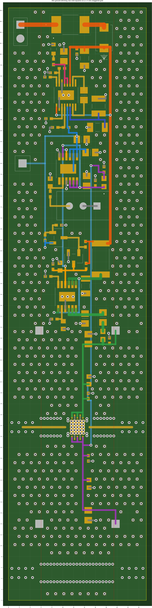
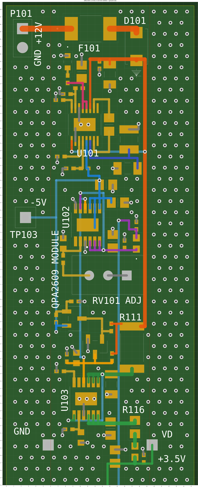

# QPA2609 模块：第二次修改手册（缝合孔重打 + 丝印）

2026-10-20 晚写。改的是**第一次 AI 实跑做完的那块板**（`PCB1_no3d.PcbDoc`），不是从头做。
执行的 AI 按第 4、5 节和 `ops_round2.jsonl` 逐条做；循环规则、on_fail 的含义、日志格式和第一次一样，见 `8_AI代理包\RUNBOOK_HAIKU.md` 第 2、4、8 节。

---

## 1　这次改什么、为什么

| # | 问题（你截图里看到的） | 原因 | 这次怎么改 |
|---|---|---|---|
| 1 | **接地缝合孔变稀了** | 原来的板子是用 AD 自带的"缝合孔"功能打的：1.5 mm 网格、隔行错开，只有**射频线**离孔 1 mm（临时规则），别的东西按正常 0.15 mm 间距，所以很密。第一次 AI 用的是 eda-agent 自己的打孔工具，它的"间距"参数一填 1 mm（39 mil），就变成**离所有东西**（每个焊盘、每根线、每个孔）都要 1 mm，很多格点被跳过；而且没错行。 | **不再让工具自己挑位置。** 我按 1.5 mm 错行网格把每个孔的坐标都算好了（602 个，其中原来 51.4 mm 那块板的范围内 316 个，原板是 333 个，密度一样），逐个检查过：离射频线 ≥ 1 mm，离别的铜 ≥ 0.2 mm，孔和孔中心距 ≥ 0.75 mm，不压焊盘、不进元件外框、不压丝印字。AI 只照表放，放完用 DRC 再筛一遍。 |
| 2 | **丝印一团乱**：47 个位号原样带进来，又大又挤，压焊盘、互相叠 | 第一次 AI 用的是加丝印之前的旧版说明书 | 按第 3 节：藏掉 37 个小元件的位号，10 个关键位号摆到算好的位置，加 11 个功能字（端子旁写电压和极性），字高统一 1.0 mm、线宽 0.16 mm |
| 3 | 板子中间（y≈51.4 mm，原来的板顶）有一条横的白色虚线 | 不确定：可能是某个机械层或禁布层上没跟着改的旧板框线 | **这次只查不删**（R0 的 RECON 步骤列出来），你看了报告再决定 |
| 4 | P101 插 2.54 排针，孔 0.9 mm 偏紧 | 第一次跳过了（说明书让它连 J3～J6 一起改，和"不准动射频部分"矛盾） | 只改 P101、TP103 的孔到 1.0 mm（可选） |

**和原来不一样的地方**：第一版说明书第 P11 步让 AI 用 `pcb_place_stitching_vias` 自动打孔；现在改成"照我算好的坐标表放 + DRC 筛"。原因就是第 1 行：工具的间距参数是全局的，做不到"只对射频线 1 mm"。`8_AI代理包` 里给以后整套重做用的清单也一起改了。

**不改的**：
- 第一次挪了 0.03 mm 的那个过孔（J3 旁边，离方焊盘 0.16 mm，规则 0.15 mm，DRC 是 0）——够用，不动。
- 原理图、元件位置、走线、铺铜设置——都不动。

---

## 2　缝合孔

| 项目 | 值 |
|---|---|
| 网格 | 1.5 mm，隔行错开半格（0.75 mm），起点 (1.2, 1.2) mm |
| 过孔 | 孔 0.25 mm（9.843 mil）/ 直径 0.5 mm（19.685 mil），网络 GND，Top→Bottom 贯通 |
| 离射频线（RFIN、RFOUT、THRU） | 铜边到铜边 ≥ 1 mm（打完 DRC 时加临时规则 RF_to_Via 再查一遍，查完**删除**规则） |
| 离别的网络的铜（所有层） | ≥ 0.2 mm（规则 0.15，留 0.05 余量） |
| 离已有过孔 | 中心距 ≥ 0.75 mm（孔到孔规则要 0.504 mm） |
| 不放的地方 | 焊盘上、元件外框里、丝印字下、四个射频连接器区域、芯片 U1 区域、离板边 < 0.75 mm |
| 数量 | 602 个（坐标表 `stitch_vias.csv`） |

**删旧孔的方法（最容易出错，第一次就误删过 14 个屏蔽孔）**：先读出全部过孔，把和 `required_vias_asbuilt.csv`（137 个原有 + 45 个数据过孔，共 182 个）对得上的（2 mil 内）排除掉，剩下的 GND 过孔**必须正好 440 个**才删。删完再数：182 个必须全在。

---

## 3　丝印

**尺寸要求**（所有新加的字都一样）

| 项目 | 值 | 说明 |
|---|---|---|
| 层 | Top Overlay | 只在正面 |
| 字体 | Stroke（默认） | 不用 TrueType |
| 字高 Text Height | **1.0 mm（39.370 mil）** | 板厂常见要求：字高 ≥ 1.0 mm 才清楚 |
| 线宽 Stroke Width | **0.16 mm（6.299 mil）** | 板厂常见最小线宽约 0.15 mm；线宽 : 字高约 1 : 6 |
| 方向 | 只用 0°（从左往右读）或 90°（从下往上读） | 不镜像（Mirror 不勾） |

**布局要求**（数据里的坐标已经按这些算好，照填就行）

1. 字不压焊盘、不压过孔：离焊盘铜皮 ≥ 0.15 mm，离过孔 ≥ 0.1 mm（压上去板厂会把字裁掉，焊接时也看不清）。
2. 字不进别的元件的外框（courtyard），字和字之间留 ≥ 0.15 mm。
3. 每个位号离**自己的**元件 ≤ 1.2 mm，而且比离任何别的元件都近 0.3 mm 以上，不会让人认错是谁的字。
4. 模块里的元件（切口 x = 6.0～19.4 之间的），它的位号也必须整个在切口之间（切下模块时字不会被切成两半）；切口外的 P101、TP103 不限。
5. 离板边 ≥ 0.3 mm。
6. 电源端子旁边写清电压和极性（《射频测试板统一设计标准_草案》丝印一行："电源端子旁写清电压和极性"）。
7. 小电阻、电容、磁珠的位号**藏起来**，焊接时对照装配图或本指南的摆放图；LED101、Q101、Q102 周围太挤，1.0 mm 的字放不下又不认错，也藏起来。
8. 射频部分原有的字（U1、J1～J8、C3～C18）**不动**。

**① 藏起 37 个位号**：C101、C102、C103、C104、C105、C106、C107、C108、C109、C110、C111、C112、C113、C114、C115、C116、C117、C118、FB101、FB102、LED101、Q101、Q102、R101、R102、R103、R104、R105、R106、R107、R108、R109、R110、R112、R113、R114、R115。

**② 10 个位号挪到这里**（Autoposition 设 Manual，字高 1.0 mm、线宽 0.16 mm）：

| 位号 | X (mm) | Y (mm) | 旋转 |
|---|---|---|---|
| U102 | 8.497 | 78.544 | 90 |
| U101 | 9.524 | 88.213 | 0 |
| U103 | 8.326 | 53.900 | 90 |
| D101 | 15.900 | 106.046 | 0 |
| F101 | 9.700 | 102.345 | 0 |
| RV101 | 11.648 | 68.383 | 0 |
| P101 | 0.500 | 107.000 | 0 |
| TP103 | 0.475 | 77.250 | 0 |
| R116 | 15.700 | 53.700 | 0 |
| R111 | 15.300 | 66.150 | 0 |

**③ 放 11 个功能字**（String，Top Overlay，字高 1.0 mm、线宽 0.16 mm）：

| 写什么 | X (mm) | Y (mm) | 旋转 | 旁边是 |
|---|---|---|---|---|
| `+12V` | 4.800 | 103.300 | 90 | P101 的 1 脚（接 12 V 正极） |
| `GND` | 4.684 | 100.341 | 90 | P101 的 2 脚（接地） |
| `-5V` | 3.200 | 81.600 | 0 | TP103 测试点（-5 V） |
| `VD` | 21.000 | 50.400 | 0 | J3（VD 端子） |
| `+3.5V` | 20.500 | 47.100 | 0 | J3 的电压：VD 约 +3.5 V |
| `VG` | 21.000 | 15.000 | 0 | J4（VG 端子） |
| `NEG` | 21.000 | 12.200 | 0 | J4 是负压（VG 约 -0.2～-1.2 V） |
| `GND` | 1.000 | 50.800 | 0 | J5（地） |
| `GND` | 1.000 | 15.400 | 0 | J6（地） |
| `ADJ` | 16.086 | 68.421 | 0 |  |
| `QPA2609 MODULE` | 7.050 | 67.750 | 90 | 模块名，竖着写 |

坐标都是**字的左下角**，板左下角为原点（旋转 90 的从下往上读，坐标是 Altium 报告的文字位置点）。

---

## 4　给 AI 的执行说明

**偏移**：第一次测得 DX = 4755.000 mil，DY = 1734.969 mil（U1 读数 (5255, 2983)）。R0 要重新测一次核对；表里的 `_mil` 坐标写入时都 **+ (DX, DY)**，读回 **− (DX, DY)** 再比。

**阶段**：

| 阶段 | 做什么 | 条数 |
|---|---|---|
| R0 | 连接、确认改的是 PCB1_no3d、备份、盘点（元件 62、过孔 622、铺铜 4）、校准、只读查那条横虚线 | 8 |
| R1 | 删 440 个旧缝合孔 → 放 602 个新孔 → 临时规则 + DRC 筛 → 查孔是否在焊盘里 → 删临时规则 → 重铺 | 611 |
| R2 | 丝印：藏 37 个位号、摆 10 个位号、放 11 个字、临时开丝印规则查一遍再关回去 | 60 |
| R3 | （可选）P101、TP103 孔改 1.0 mm | 3 |
| R4 | DRC、数过孔、保存、写报告 | 4 |

**新增的 op 类型和工具**（其余同 RUNBOOK_HAIKU 第 5 节；第一次实跑已经验证过的工具标 ✔）：

| op | 工具 | 注意 |
|---|---|---|
| CHECK_DOCUMENTS | `proj_list_documents` ✔ | 不是 PCB1_no3d 就停 |
| RECON_MECH_LINE | `obj_query`（Track/Arc/Region/Fill，按层） | 只读，不删 |
| PCB_DELETE_STITCH_RUN1 | `pcb_get_vias` ✔ + `obj_batch_delete` ✔（精确 X/Y/Net 过滤，板上存的是小数 mil） | 正好 440 才删 |
| PCB_VIA / COUNT_VIAS | `pcb_place_vias` ✔ / `pcb_get_board_statistics` ✔ | 每批 ≤ 30；它只收整数 mil 的话，放完用 `obj_batch_modify` ✔ 改成精确值 |
| PCB_RULE / PCB_RULE_DELETE | `pcb_create_design_rule` ✔ / `pcb_delete_design_rule` ✔ | 只禁用不行，DRC 照样算 |
| DRC_PRUNE_NEW_VIAS / DRC / SILK_DRC_CHECK | `pcb_run_drc(allow_modal=true)` ✔ + `app_press_dialog_button` 按"运行DRC" ✔；以 `Project Outputs for QPA2609_test\Design Rule Check - PCB1_no3d.drc` 报告为准 | 只删 stitch_vias.csv 里的孔 |
| PAD_CONTAIN_CHECK | `obj_query` ePadObject ✔ | 算不了就 REPORT |
| SILK_HIDE_DESIGNATOR / SILK_SET_DESIGNATOR | `obj_modify` / `obj_batch_modify`（元件位号文字：Hide、X、Y、Rotation、Size、Width、Autoposition、Mirror） | 找不到能改的属性就 LOG_CONTINUE |
| SILK_STRING | 放 PCB 文字的工具（`tool_catalog` 里找 text / string） | 同上 |
| PCB_SET_PAD_HOLE | `obj_modify`（Pad 的 HoleSize） | 只改 P101、TP103 |

**禁止**：
- 不动原有的射频对象（包括它们的丝印）；
- 不删 `required_vias_asbuilt.csv` 里的任何过孔；
- 不改走线、元件、铺铜设置；
- 不改除 RF_to_Via 之外的规则（丝印两条规则只能临时打开，最后必须关回 Disabled）。

---

## 5　你自己要做的（AI 做不了或不该做）

1. **阻焊最小间隙规则**：设计 → 规则 → Manufacturing → Minimum Solder Mask Sliver，值改 `0.08mm` 并勾 Enabled，跑 DRC。可能报 1 条 C118 和 J3 之间 0.079 mm，差 0.001 mm，可以不管。（eda-agent 改不了这类规则。）
2. **核对原理图和 PCB 同步**：**设计 → Update PCB Document PCB1_no3d.PcbDoc**，看弹出的变更列表：空的或只有很少几项 Change 就点 Close；出现 **Remove** 就点 Cancel 截图发我。（第一次没走正常 ECO，用这一步确认。）
3. 看 R0 报告里那条 y≈51.4 mm 的横线是什么层的什么东西，发我决定删不删。
4. 看一眼板子下边 J7/J8 附近那排屏蔽孔（第一次补回来的 14 个）是否整齐。
5. 最后自己出 Gerber。

---

## 6　报告（AGENT_REPORT_round2.md）

1. 改的文件名、备份位置、偏移；
2. R1：删了几个旧孔（应 440）、放了几个新孔、DRC 筛掉几个、焊盘检查删掉几个、最终过孔数；
3. R2：每个位号 / 字是否设成功，失败的列出来；丝印 DRC 涉及新字的违规；
4. R0 查到的横线对象清单；
5. 最终 DRC 汇总；
6. 跳过 / 失败的步骤和原因。

---

## 7　文件

| 文件 | 内容 |
|---|---|
| `ops_round2.jsonl` / `.csv` | 686 条按顺序的操作 |
| `stitch_vias.csv` | 602 个新缝合孔坐标（mm 和 mil，板左下角原点） |
| `required_vias_asbuilt.csv` | 必须保留的 182 个过孔（按第一次做完的实际位置） |
| `silk.json` | 丝印数据 |
| `图\缝合孔.png`、`图\丝印.png` | 预览图 |
